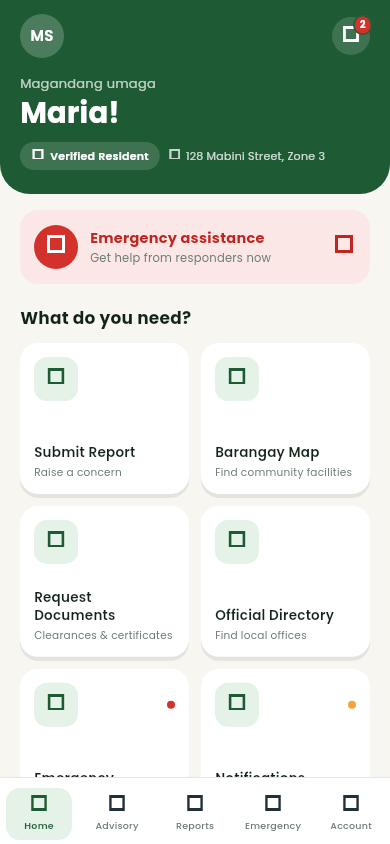
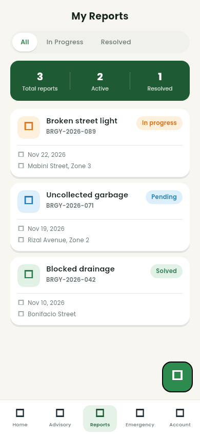
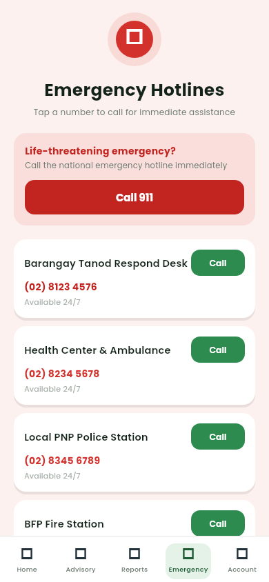
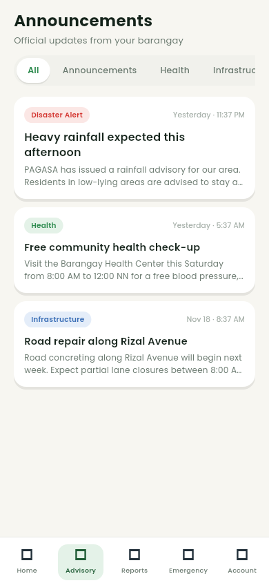
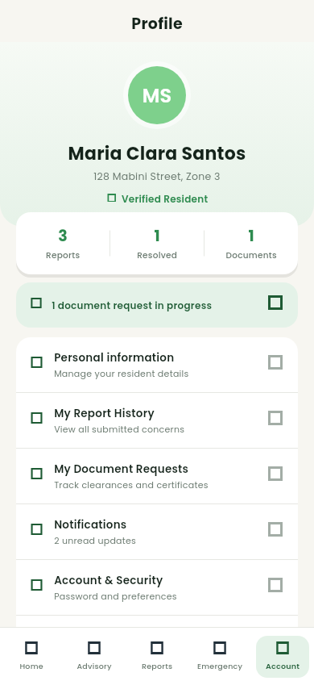
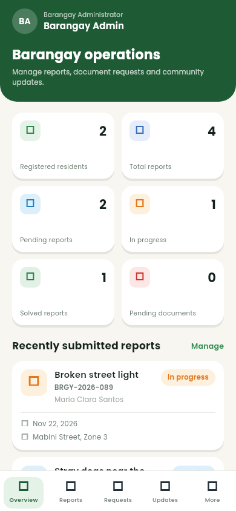

# Barangay Sumbungan

**"Ang Boses at Saklolo ng Bawat Barangay."**


The brand mark is a speech bubble holding a house: the voice of the barangay,
at home. Master artwork lives in `docs/branding/` (rounded-square icon, round
icon, and transparent marks for dark and light backgrounds); the Android
launcher icons, adaptive icon foreground and in-app splash asset are generated
from it. Brand green `#1E5B34`, cream `#FBF8F1`.

A Flutter mobile application (Android-first) that gives residents one place for
barangay services: emergency assistance, notifications, community reports,
document requests, the barangay map, the official directory and announcements.
A separate administrator interface lets barangay officials process reports,
document requests, announcements, the directory, residents and notifications.

The interface follows the **Fidelity V1** design reference: dark forest-green
headers, cream backgrounds, white rounded cards, pale-green icon tiles, pill
inputs and buttons, and the five-tab bottom navigation (Home, Advisory, Reports,
Emergency, Account) with the pale-green active tile.

## Feature map

| Module | Resident | Administrator |
| --- | --- | --- |
| Emergency Assistance | Hotline list, 911 shortcut, call confirmation, `tel:` dialer | Manage hotlines (add/edit/remove) |
| Notifications | History, unread badges, mark read/all read, related-record routing | Compose to all/selected residents, review records |
| Submit Reports | Category, date, description, location, up to 5 photos, reference number, status timeline | Search/filter, review evidence, update status, response, notify resident |
| Request Documents | Document types, request form, reference number, status tracking | Search/filter, process statuses, instructions, notify resident |
| Barangay Map | Facility guide, details, directions, clear map-setup state | Manage facilities and verified coordinates |
| Official Directory | Officials/offices, search, one-tap calling | Full CRUD |
| Latest Announcements | Category feed, detail screen | Create, edit, publish/draft, delete, notify residents |
| Accounts | Register, sign in, persistent session, profile edit, password change, help | Resident accounts, suspend/reactivate |

## Screens

Rendered from the app at a 390 × 844 mobile viewport (Material icons are omitted
in these test renders, which use the bundled Poppins font only).

| Resident home | My Reports | Emergency |
| --- | --- | --- |
|  |  |  |

| Announcements | Profile | Administrator |
| --- | --- | --- |
|  |  |  |

## Run the app

Requirements: Flutter 3.24+ (Dart 3.5+), Android SDK / device or emulator.

```bash
flutter pub get
flutter run                 # debug on a connected Android device
flutter build apk --release # installable Android build
```

Quality checks used during development:

```bash
flutter analyze
flutter test
```

### Demo accounts

| Role | Email | Password |
| --- | --- | --- |
| Resident | `maria@example.com` | `Resident123!` |
| Administrator | `admin@barangay.gov.ph` | `Admin123!` |

Use the "Use" buttons on the sign-in screen to fill these in. New registrations
always become residents. Directory, hotline and facility entries are clearly
labelled sample records until the barangay publishes official information — no
real names, numbers or coordinates are invented.

## Architecture

```
lib/
├── main.dart                 # bootstrap + state creation
├── app.dart                  # MaterialApp, theme, routes, AppScope
├── core/
│   ├── constants/            # identity, statuses, collection names
│   ├── theme/                # Fidelity V1 colour + theme tokens
│   ├── routes/               # named routes and generators
│   ├── utils/                # formatters, validators, phone/map launchers
│   └── widgets/              # buttons, cards, inputs, badges, nav, dialogs
├── models/                   # user, report, document, announcement,
│                             # notification, directory/hotline/location
├── providers/                # AppState (ChangeNotifier) + AppScope
├── services/
│   ├── auth_service.dart     # sign in/up, session restore, password reset
│   ├── report_service.dart
│   ├── document_service.dart
│   ├── announcement_service.dart
│   ├── notification_service.dart
│   ├── directory_service.dart
│   ├── storage_service.dart  # photo selection / upload hook
│   └── backend/              # BarangayBackend interface + LocalBackend
└── screens/
    ├── splash/  authentication/
    ├── resident/ dashboard, emergency, notifications, reports, documents,
    │             map, directory, announcements, account
    └── admin/    dashboard, reports, documents, announcements, residents,
                  directory & map, notifications, more
```

State management is a single `AppState` (`ChangeNotifier`) shared through
`AppScope` (`InheritedNotifier`). Screens call use-case methods; only the service
layer talks to the backend, and only the backend knows about storage.

## Data layer and Firebase

`BarangayBackend` is the seam between services and storage. The Android app
currently selects `FirebaseBackend`: accounts use Firebase Authentication and
profiles and service records use Cloud Firestore. `LocalBackend` remains
available for tests and offline development.

Firebase Authentication must have email/password sign-in enabled, and
`firestore.rules` must be deployed to the configured Firebase project.
Registration creates the Authentication account first and then its Firestore
profile. If that profile write fails, signing in again retries profile setup
for the account.

## Known limits

- Firebase Authentication and Firestore are configured for Android. Firebase
  Cloud Messaging and Google Maps are not configured.
- Photo evidence stores the picked file path on the device until Storage is
  configured.
- Push delivery requires the Firebase project and a Cloud Function.
- English UI only; the Fidelity reference also shows a Filipino variant, which
  would need a full localisation pass.
